# Dossiê Comparativo: Zernio vs. Postiz vs. Buffer (Operação Registoo — IG, TikTok e Shorts)

> **Autora:** `EDITH` (Pesquisadora de Mercado, Concorrentes, Regulatório e Dores)
> **Contexto:** Escolha da infraestrutura de agendamento, aprovação humana (*human-in-the-loop*) e coleta automatizada de métricas pelo `Fury` para os canais do **Registoo** (**Instagram**, **TikTok**, **YouTube Shorts** e **Facebook**).
> **Decisão Fechada (2026-11-28):** Combo híbrido Custo Zero (`$0/mês`) com **Zernio Free** (Instagram + TikTok) + **Buffer Free** (YouTube Shorts + Facebook opcional), ambos operados pelo **`Fury`** via MCP com aprovação do Gabriel direto no chat do OpenBot (sem necessidade de acessar os painéis web do Zernio/Buffer).
> **Referência cruzada:** [[2026-11-19-explorar-ferramentas-de-agendamento-de-posts]], [[2026-11-25-blueprint-fury-estrategista-marketing]] e [[2026-11-27-runbook-setup-vps-openbot]].

---

## 1. Resumo Executivo & Veredito Rápido

| Critério | Zernio | Buffer | Postiz (Cloud / Self-Hosted) |
|---|---|---|---|
| **Modelo** | SaaS API-first / AI-native (`[FONTE VERIFICADA]`) | SaaS tradicional + GraphQL/MCP (`[FONTE VERIFICADA]`) | SaaS pago ou Open-Source Self-Hosted (`AGPL-3.0`) (`[FONTE VERIFICADA]`) |
| **Free Tier (IG + TikTok + YT Shorts)** | **2 contas grátis** ($0). Para 3+ redes, da 3ª à 10ª conta custa **US$ 6/conta/mês** (`[FONTE VERIFICADA]`) | **3 canais grátis** ($0), limite de **10 posts na fila/canal** (`[FONTE VERIFICADA]`) | **Cloud:** sem Free Tier (só 7 dias trial; começa em US$ 29/mês). **Self-Hosted:** $0/ilimitado (`[FONTE VERIFICADA]`) |
| **Posts e recursos no Free Tier** | Ilimitados (analytics completo, DMs, comentários, API e MCP inclusos) (`[FONTE VERIFICADA]`) | 10 agendados por vez/canal, 1 usuário, analytics limitado a **30 dias** (`[FONTE VERIFICADA]`) | Ilimitados no Self-Hosted (custo de configurar apps OAuth próprios) (`[FONTE VERIFICADA]`) |
| **MCP / API oficial p/ `Fury` puxar métricas** | **Sim (Nativo e completo):** REST API + MCP (`mcp.zernio.com/mcp`) + `GET /v1/metrics/insights` + webhook `analytics.synced` (`[FONTE VERIFICADA]`) | **Sim:** GraphQL API (`api.buffer.com`) + MCP (`mcp.buffer.com/mcp`) com escopo `insightsRead` (3.000 req/mês no Free) (`[FONTE VERIFICADA]`) | **Sim:** Public REST API (`GET /public/v1/analytics/{integration}`) + MCP Server (~14 tools) (`[FONTE VERIFICADA]`) |
| **Aprovação humana antes de publicar** | **Sim ($0):** aprovação direto com o `Fury` no OpenBot (que dispara via MCP) ou rascunho `is_draft: true` (`[FONTE VERIFICADA]`) | **Sim ($0):** aprovação direto com o `Fury` no OpenBot (que agenda via MCP/GraphQL) ou rascunho `Draft` (`[FONTE VERIFICADA]`) | **Sim:** criação como `draft` via MCP/API + RBAC multi-usuário liberado no Self-Hosted (`[FONTE VERIFICADA]`) |
| **Automação de Comentários / DMs (estilo ManyChat)** | **Sim, nativo** na mesma API/MCP e incluso desde o Free Tier (`[FONTE VERIFICADA]`) | Comunidade básica na UI; sem automação estilo ManyChat via API no Free (`[FONTE VERIFICADA]`) | Foco em publicação; leitura/automação profunda de DMs via API é limitada (`[FONTE VERIFICADA]`) |
| **Self-Hosted na VPS** | Não (100% SaaS) (`[FONTE VERIFICADA]`) | Não (100% SaaS) (`[FONTE VERIFICADA]`) | **Sim** (Docker Compose: App + Postgres + Redis + Temporal), mas exige **App Review próprio** na Meta/TikTok/Google (`[FONTE VERIFICADA]`) |

---

## 2. Análise Detalhada por Critério

### (1) O que cabe no Free Tier (foco: Instagram + TikTok + YouTube Shorts)

1. **Buffer — Cobre até 3 canais a $0/mês, mas com teto de fila e métricas mais simples**
   - **Canais no Free ($0):** até **3 canais sociais** conectados (`[FONTE VERIFICADA]` — https://buffer.com/pricing).
   - **Limite de agendamentos:** até **10 posts agendados simultaneamente por canal** (30 no total). Como é um limite de *fila ativa* (e não limite mensal), assim que um post é publicado a vaga reabre (`[FONTE VERIFICADA]` — https://buffer.com/pricing).
   - **Limites específicos para YouTube Shorts no Buffer Free:**
     - Teto de *fair-use* de até **2 vídeos publicados por período de 24 horas** no plano gratuito (`[FONTE VERIFICADA]` — https://support.buffer.com/).
     - Suporta vídeos até **10 GB** (`.MP4`, `.MOV`, etc.), título de até **100 caracteres** e descrição de até **5.000 caracteres** com hashtags clicáveis (`[FONTE VERIFICADA]` — https://support.buffer.com/).
     - **Limitações técnicas no Shorts:** (a) não permite subir *thumbnail* (capa) customizada para Shorts via agendamento no Buffer; (b) não permite anexar músicas da biblioteca nativa do YouTube no autopublish — o que **não afeta o Registoo**, pois os vídeos da `Zoe` (Remotion / Frente B) já saem renderizados com locução e trilha próprias no `.mp4` (`[FONTE VERIFICADA]` — https://support.buffer.com/).
   - **Outras restrições do Free:** apenas **1 usuário**, histórico de métricas (*insights*) travado em **30 dias**, sem agendamento de primeiro comentário (`[FONTE VERIFICADA]` — https://buffer.com/pricing).

2. **Zernio — Free Tier sem trava de funcionalidades, limitado a 2 contas grátis ($0 p/ 2 redes)**
   - **Modelo Pay-per-Account sem feature gating:** não existem planos que escondem funcionalidades. Todas as contas conectadas (inclusive as 2 gratuitas) têm **posts ilimitados, analytics completo, gestão de comentários e DMs, REST API completa e servidor MCP hospedado** (`[FONTE VERIFICADA]` — https://zernio.com/pricing).
   - **Limite do Free ($0):** as **2 primeiras contas sociais são 100% gratuitas** (sem cartão de crédito) (`[FONTE VERIFICADA]` — https://zernio.com/pricing).
   - **Escala futura (3ª a 10ª conta):** na faixa de 3 a 10 contas, o preço é de **US$ 6 por conta/mês** (contas 11–100 caem para US$ 3/conta e 101+ para US$ 1/conta) (`[FONTE VERIFICADA]` — https://zernio.com/pricing).
   - *Nota `[SEM FONTE — REVISAR ANTES DE CITAR]`:* confirmar no checkout autenticado da Zernio se ao adicionar a 3ª conta a cobrança incide apenas sobre a conta excedente (US$ 6/mês) ou sobre o bloco de 3 contas (US$ 18/mês); a documentação pública descreve bandas graduadas (*"First 2 accounts free, accounts 3–10: $6/account/mo"*).

3. **Postiz — Zero Free Tier no Cloud; 100% gratuito apenas no Self-Hosted**
   - **Postiz Cloud:** não tem plano gratuito permanente, apenas **7 dias de teste grátis**. O plano mínimo (*Standard*) custa **US$ 29/mês** (5 canais, 400 posts/mês, 1 usuário) e o *Team* custa **US$ 39/mês** (10 canais, posts e usuários ilimitados) (`[FONTE VERIFICADA]` — https://postiz.com/pricing).
   - **Postiz Self-Hosted:** código aberto sob licença **AGPL-3.0**, **100% gratuito** sem limite de canais, posts ou membros na própria VPS (`[FONTE VERIFICADA]` — https://github.com/gitroomhq/postiz-app).

---

### (2) MCP e API Oficial: Comparativo de Riqueza de Métricas para o `Fury`

Mesmo com o `Fury` puxando as métricas semanalmente toda segunda-feira (o que contorna a trava de 30 dias de histórico do Buffer Free ao salvar tudo em `registoo-check/marketing/metricas/AAAA-Wnn.md`), **o Zernio é muito mais rico em dados de analytics do que o Buffer**.

#### Cruzamento com a Planilha Semanal do Registoo (`registoo-check/marketing/metricas/2026-W48.md`)

| Métrica exigida pelo Registoo (`marketing/metricas/`) | Zernio API / MCP | Buffer GraphQL / MCP | Observação Técnica |
|---|---|---|---|
| **Alcance por post (`reach`)** | ✓ | ✓ | Ambos entregam via API (`[FONTE VERIFICADA]`). |
| **Salvamentos (`saves`)** | ✓ | ✓ | Ambos entregam (`saves` no Zernio e no `PostMetricType` do Buffer) (`[FONTE VERIFICADA]`). |
| **Compartilhamentos (`shares`)** | ✓ | ✓ | Ambos entregam (`[FONTE VERIFICADA]`). |
| **Visualizações e curtidas (`views` / `likes`)** | ✓ | ✓ | Ambos entregam (`[FONTE VERIFICADA]`). |
| **Média assistida em Reels/vídeos (`watch time`)** | ✓ | — | **Zernio** expõe `igReelsAvgWatchTime`, `igReelsVideoViewTotalTime` e `watch time` via `GET /v1/analytics` e `GET /v1/metrics/insights`. **Buffer** entrega apenas `views` brutos (`[FONTE VERIFICADA]`). |
| **Visitas ao perfil (`profile_views` / `profileViews`)** | ✓ | — | **Zernio** entrega no endpoint de conta/insights (`GET /v1/metrics/insights`). **Buffer** GraphQL é restrito a métricas de post individual (`[FONTE VERIFICADA]`). |
| **Cliques no link da bio (`website_clicks`)** | ✓ | — | **Zernio** entrega `website_clicks` nos insights da conta Instagram. **Buffer** só mede cliques em links dentro do próprio post (`[FONTE VERIFICADA]`). |
| **Seguidores ganhos por canal (`follows` / `follower-history`)** | ✓ | — | **Zernio** entrega `follows_and_unfollows` e `/v1/analytics/instagram/follower-history`. **Buffer** não expõe variação de seguidores na API GraphQL (`[FONTE VERIFICADA]`). |
| **Texto literal dos comentários e DMs** | ✓ | — | **Zernio** entrega o texto completo (ouro para alimentar `dores-e-subdores.md`). **Buffer** retorna apenas a contagem numérica `comments` (`[FONTE VERIFICADA]`). |
| **Retenção exata aos 3 segundos (`Retenção 3 s`)** | — | — | **Limitação das próprias redes:** nem a Graph API da Meta nem a API do TikTok exportam a taxa percentual exata dos 3s para ferramentas externas (`[FONTE VERIFICADA]`). |

*(Nota `[SEM FONTE — REVISAR ANTES DE CITAR]`: verificar com token real conectado se o breakdown `% de não seguidores` via grouping `follower_type` vem habilitado por padrão na resposta de `GET /v1/metrics/insights` do Zernio e se o campo `reach` do Buffer para YouTube Shorts vem preenchido além de `views`).*

---

### (3) Quem realiza as postagens e como funciona a Aprovação Humana (*Human-in-the-Loop*)

#### A. Qual agente realiza as postagens? **O próprio `Fury` (sem criar agente novo)**
- Conforme definido em [[2026-11-25-blueprint-fury-estrategista-marketing]] (Seção 2 — *Coleta de métricas desacoplada v1 → v2*), **os servidores MCP do Zernio e do Buffer ficam plugados diretamente no `Fury`**.
- **Por que não criar um agente separado só para postar:**
  - `Hill` (Roteirista) e `Zoe` (Diretora Visual) têm limite rígido de atuar apenas em arquivos locais (`marketing/pecas/` e `apps/video/out/`).
  - O `Fury` já é o dono das duas pontas do ciclo: ele define o calendário (`marketing/calendario/AAAA-Wnn.md`, com data, horário, rede e UTM) e analisa os resultados na segunda-feira (`marketing/metricas/AAAA-Wnn.md`).

#### B. Aprovação 100% dentro do OpenBot (Zero necessidade de abrir painéis do Zernio ou Buffer)
- **O Gabriel não precisa entrar nos dashboards web do Zernio nem do Buffer para aprovar peças.**
- **Fluxo operacional fechado:**
  1. `Hill` entrega roteiro + `legenda.md` em `marketing/pecas/AAAA-MM-DD-slug/`.
  2. `Zoe` renderiza o `.mp4` ou os slides do carrossel.
  3. `Fury` apresenta a peça finalizada + legenda + data/horário sugeridos para o Gabriel **diretamente no chat do OpenBot**.
  4. O Gabriel analisa no próprio OpenBot e sinaliza o **`approve` direto para o `Fury`**.
  5. Com o `approve` do Gabriel, o próprio **`Fury` dispara o agendamento/publicação via MCP** (`https://mcp.zernio.com/mcp` para Instagram/TikTok e `https://mcp.buffer.com/mcp` para YouTube Shorts/Facebook).
  6. *(Opcional/Fallback)* Caso o `Fury` suba antes da revisão final, ele envia com flag de rascunho (`is_draft: true` no Zernio / `Draft` no Buffer) e só muda o status para agendado/publicado via MCP após receber o `approve` do Gabriel no chat.

```mermaid
flowchart LR
    EDITH["1. EDITH (Dores e Dossiês)"] --> FURY1["2. Fury (Pauta e Briefing)"]
    FURY1 --> HILL["3. Hill (Roteiro e Legenda)"]
    HILL --> ZOE["4. Zoe (Render MP4 / Slides)"]
    ZOE --> FURY2["5. Fury (Mostra preview ao Gabriel no OpenBot)"]
    FURY2 --> GABRIEL["6. Gabriel (Analisa e dá approve no chat)"]
    GABRIEL --> FURY3["7. Fury (Agenda via MCP no Zernio + Buffer)"]
    FURY3 --> FURY4["8. Fury (Puxa Métricas na Segunda via MCP)"]
```

---

### (4) Requisitos caso Self-Hosted (Postiz na nossa VPS) — Por que foi descartado agora

Apenas o **Postiz** pode ser hospedado na nossa VPS (`Zernio` e `Buffer` são 100% cloud).

1. **Hardware e Containers (`[FONTE VERIFICADA]` — https://docs.postiz.com/self-host/installation/docker-compose):**
   - Stack Docker Compose oficial (`gitroomhq/postiz-docker-compose`): `postiz` (porta `4007`), `PostgreSQL`, `Redis` e `Temporal` (porta `8080`), exigindo no mínimo **2 vCPUs, 2–4 GB de RAM e 20 GB de disco** + proxy reverso HTTPS.
   - A nossa VPS atual do OpenBot (**4 vCPUs, 15 GiB de RAM com ~13 GiB livres e 113 GiB de disco livres**) suportaria o hardware com folga (`[FONTE VERIFICADA]`).
2. **O Gargalo Impeditivo (App Review próprio nas 3 redes):**
   - No Postiz Self-Hosted você **não** usa os apps OAuth pré-aprovados do Postiz Cloud. É obrigatório criar e aprovar apps próprios de desenvolvedor no **Meta for Developers** (verificação de negócio + screencast), no **TikTok for Developers** (*Content Posting API*, que trava vídeos como privados *Self-Only* até passar por auditoria humana) e no **Google Cloud Console** (*YouTube Data API v3*, cota de 10.000 unidades/dia) (`[FONTE VERIFICADA]` — https://docs.postiz.com/self-host/installation/docker-compose). Isso atrasaria a operação em **1 a 4 semanas**.

---

## 3. Decisão Arquitetural Fechada para o Registoo (Combo Custo Zero → Escala)

### Fase Atual — Custo Zero (`R$ 0/mês`) com Inteligência Máxima
1. **Zernio Free (`$0/mês` — 2 contas grátis):**
   - Conectar **Instagram + TikTok** (as duas redes principais de topo/meio de funil).
   - Plugar o MCP `https://mcp.zernio.com/mcp` no **`Fury`** para agendamento pós-`approve`, coleta semanal das métricas completas (`reach`, `saves`, `shares`, `igReelsAvgWatchTime`, `profile_views`, `website_clicks`, `follows`) e leitura do texto literal dos comentários e DMs.
2. **Buffer Free (`$0/mês` — até 3 canais grátis):**
   - Conectar **YouTube Shorts** (e opcionalmente a página do **Facebook** do Registoo, já que sobram 2 canais gratuitos no Buffer).
   - Plugar o MCP `https://mcp.buffer.com/mcp` (e GraphQL `https://api.buffer.com` com escopo `insightsRead`) no **`Fury`** para agendar os Shorts após o `approve` do Gabriel no chat e puxar `views`, `reactions`, `comments` e `shares` toda segunda-feira.
   - **Zero atrito de usar 2 ferramentas:** como o Gabriel aprova tudo falando diretamente com o **`Fury` no OpenBot**, o `Fury` abstrai os dois MCPs por baixo dos panos.

### Gatilho de Upgrade Futuro (quando houver giro de caixa)
- Quando o Registoo tiver giro de caixa e quiser unificar também o `watch time` e a leitura de comentários do YouTube no mesmo endpoint, basta desconectar o YouTube do Buffer e adicioná-lo como **3ª conta no Zernio (`US$ 6/mês`)**. Todo o histórico semanal anterior já estará salvo em Markdown em `registoo-check/marketing/metricas/`.

---

## 4. Duplo Impacto (Munição de Marketing & Backlog de Operação/Produto)

### Munição de Marketing (para `Fury`, `Hill` e `EDITH`)
- **Mineração automática da Voz do Cliente nos comentários:** com o MCP do Zernio conectado ao Instagram e ao TikTok, toda segunda/quarta-feira o `Fury` e a `EDITH` podem ler o texto real dos comentários e DMs nas peças publicadas para capturar frases literais de gestores e terapeutas e alimentar `registoo-check/marketing/dores-e-subdores.md`.

### Oportunidades de Produto / Operação (para avaliação do Gabriel)
- **Fechamento da issue exploratória [[2026-11-19-explorar-ferramentas-de-agendamento-de-posts]]:** além do agendamento a custo zero com aprovação via chat no `Fury`, o Zernio já deixa pronta a infraestrutura oficial de API/MCP para automatizar respostas a comentários + envio de link/isca por DM no Instagram (estilo ManyChat) sem pagar ferramenta extra.

---

## 5. Fontes Consultadas

- `[FONTE VERIFICADA]` Zernio Pricing & Free Tier (2 contas grátis, US$ 6/conta de 3–10, todos os recursos inclusos): https://zernio.com/pricing
- `[FONTE VERIFICADA]` Zernio Documentation, Analytics (`GET /v1/analytics`, `GET /v1/metrics/insights`, `igReelsAvgWatchTime`, `profile_views`, `website_clicks`, `follower-history`) & Hosted MCP Server (`https://mcp.zernio.com/mcp`): https://docs.zernio.com/ e https://docs.zernio.com/mcp
- `[FONTE VERIFICADA]` Buffer Pricing & Free Plan Limits (3 canais grátis, 10 posts na fila/canal, 30 dias de analytics): https://buffer.com/pricing
- `[FONTE VERIFICADA]` Buffer Developers — GraphQL API (`https://api.buffer.com`), MCP Server (`https://mcp.buffer.com/mcp`), `PostMetricType` & `insightsRead` (3.000 req/mês no Free): https://developers.buffer.com/
- `[FONTE VERIFICADA]` Buffer Help Center — YouTube Shorts Scheduling & Limits (2 posts/24h no Free, títulos 100 chars, vídeos até 10 GB, sem custom thumbnail via API): https://support.buffer.com/
- `[FONTE VERIFICADA]` Postiz Pricing (Cloud sem free tier permanente, 7 dias trial, a partir de US$ 29/mês): https://postiz.com/pricing
- `[FONTE VERIFICADA]` Postiz Repositório Oficial Open-Source (Licença AGPL-3.0): https://github.com/gitroomhq/postiz-app
- `[FONTE VERIFICADA]` Postiz Self-Hosted Docker Compose (PostgreSQL, Redis, Temporal, requisitos de HTTPS e credenciais OAuth próprias por rede): https://docs.postiz.com/self-host/installation/docker-compose
- `[FONTE VERIFICADA]` Postiz Public REST API & Analytics (`GET /public/v1/analytics/{integration}`) e MCP Tools: https://docs.postiz.com/public-api/introduction
